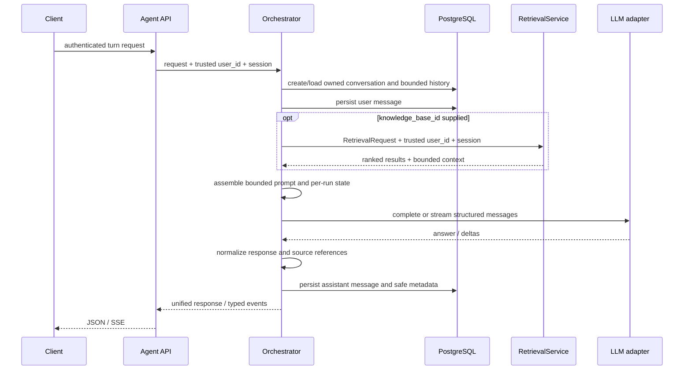

# Agent orchestration architecture

Status: final architecture recommendation for the initial implementation. This document defines the recommended choices; implementation remains a separate task.

## Executive recommendation

Add a provider-neutral, single-agent orchestration layer in `app/agent/`. Use a regular asynchronous Python service as the first runtime: it loads conversation context, optionally calls the existing retrieval service, constructs a bounded prompt, calls an LLM port, and persists the result. Add explicit tool-call handling only when the product needs tools beyond retrieval. This keeps the first implementation testable and avoids adopting a graph runtime without a graph-shaped requirement.

LangGraph is already a dependency and is used by `LangGraphChatGateway`, but only for a two-node render-and-generate flow. The current gateway is coupled to `GeminiClient`, and the selected path is controlled by `use_langgraph_chat`; it is not a provider-neutral agent runtime and does not currently implement tool cycles, durable checkpoints, or multi-agent behavior. Do not reuse it as the new orchestration boundary. Keep existing chat behavior intact; consider LangGraph later if conditional tool loops, resumable execution, or graph-level human approval become demonstrated requirements.

## Repository audit

| Area | Existing shape | Consequence for agent orchestration |
|---|---|---|
| Agent package | `app/agent/` exists and is empty. | Place the domain orchestration modules here; keep HTTP wiring under `app/api/v1/` and schemas under `app/schemas/`, consistent with current layout. |
| Ingestion | `app/rag/ingestion/` normalizes, chunks, and coordinates document/version/job state; `workers/` dispatches asynchronous ingestion. | Agent calls must not load, chunk, embed, or index documents. |
| Retrieval | `RetrievalService.retrieve(RetrievalRequest, authenticated_user_id, session)` returns ranked `RetrievalResult` records and bounded `AssembledContext`. Its preparer validates scope and resolves active versions from user-owned documents. | The agent must call this service; it must not query Qdrant or reimplement authorization/retrieval. Treat its context and provenance as the source context. |
| Authentication | FastAPI uses `get_current_access_claims`; authenticated identity is the token `sub`. Existing routes derive `user_id` from claims. | Resolve a trusted principal at the route boundary and pass it as a separate, required service argument. Never put user identity in request schemas. |
| Conversation persistence | `ChatSession` has an owning `user_id`; `ChatMessage` has `chat_id`, `user_id`, role, content, and timestamp. `ChatService.get_chat` scopes by chat ID and user ID; message queries also filter on both. Support chat has parallel dedicated tables. | Prefer the existing general chat tables for initial agent conversations to avoid duplicate conversation infrastructure. Agent persistence needs a careful extension for message metadata and atomic turn handling. Do not reuse support chat tables. |
| LLM integrations | `GeminiClient` offers async generate and stream methods. `ChatRuntimePort` abstracts the existing chat gateways, but includes retrieval text in its interface. `LangChainChatGateway` and `LangGraphChatGateway` each build prompts and directly call Gemini. | Define a narrower new provider port for message-based completion and streaming. Put Gemini/OpenAI/etc. adapters in `app/infra/llm/`; orchestration should not import provider SDKs. |
| Framework use | `langchain`, `langgraph`, `langchain-openai`, and `google-genai` are dependencies. LangGraph usage is limited to the legacy chat gateway. | Existing dependencies do not require a new framework or a new infrastructure service. Do not build a multi-agent design. |
| API/dependency wiring | Routers are registered in `app/routers/api.py`. FastAPI dependencies and `get_*` factories wire services; retrieval exposes `get_retrieval_service()` and tests use dependency overrides. | Add an agent dependency factory using the same pattern; inject service ports so unit tests can use fakes. |
| Configuration | Pydantic `Settings` centralizes provider keys/models, RAG defaults, and the legacy `use_langgraph_chat` switch. | Add only needed agent defaults (provider/model, history budget, timeout/output bounds) when implementation begins; no new service URLs are implied. Never expose credentials in schemas. |
| Errors/logging | Routes translate domain errors into HTTP errors; services use module loggers and avoid leaking provider details. | Keep domain errors in `app/agent/`, map them at the API edge, and log request/conversation IDs and timings without prompts, tokens, or user content. |
| Tests | Pytest unit/API tests use fakes, dependency overrides, and async test clients; RAG has focused service tests. Integration tests are separately marked. | Cover orchestrator logic with fake retrieval/provider/store ports; API tests must verify user scoping and stream event order. No live services should be needed for ordinary tests. |

### Important current limitations to account for

- `ChatMessage` only allows `user`, `assistant`, and `system` roles and has no structured metadata field for citations or tool events. If tool calls are persisted as first-class messages, add a reviewed migration or keep them in assistant metadata; do not silently broaden the existing API contract.
- Existing `ChatService` has its own legacy retrieval-context builder, vector memory behavior, provider-specific initialization, and streaming methods. The new agent should not call that service for RAG; it should consume `RetrievalService` directly and own its orchestration.
- The retrieval request carries `knowledge_base_id` and retrieval options, but no identity. Its service requires trusted `authenticated_user_id` and a database session. Preserve this exact trust split.
- Existing stream surfaces include WebSocket and support event patterns. For the new text agent, Server-Sent Events (SSE) is the recommended first transport for a normal HTTP request that streams tokens; reuse the event contract if WebSocket support is later needed.

## Recommended directory structure

```text
app/agent/
  __init__.py
  models.py             # provider-neutral request, result, state and event values
  ports.py              # LLM, retrieval, conversation store and tool protocols
  orchestrator.py       # one-turn use case and execution sequence
  runtime.py            # simple runtime policy: retrieval, prompt, model, processing
  prompts.py             # system prompt templates and version identifiers
  context.py             # history selection and prompt-budget assembly
  tools/
    __init__.py
    registry.py          # explicit allowlisted tool registration and lookup
    retrieval.py         # adapter to existing RetrievalService, if exposed as a tool
  persistence.py         # ChatSession/ChatMessage-backed conversation store
  dependencies.py        # construction/wiring of ports and service
  errors.py              # stable domain exceptions
app/api/v1/agent.py      # authenticated routes and SSE serialization
app/schemas/agent_api.py # request/response/event-facing schemas
```

The exact file split can remain smaller until it is needed. In particular, do not create a second retrieval package or a framework-specific graph package in the first iteration.

## Component responsibilities and boundaries

### Agent API

Owns transport concerns only: validate the payload, obtain the authenticated user from access claims, pass the database session and trusted user ID to the use case, map expected errors, and serialize either JSON or SSE. The route does not assemble prompts, call providers, or perform direct database scope lookups outside the conversation store.

Recommended routes:

- `POST /api/v1/agent/turn` — one-shot JSON interaction.
- `POST /api/v1/agent/turn/stream` — same request body, `text/event-stream` response.
- `GET /api/v1/agent/conversations/{conversation_id}/messages` — optional if the existing chat messages route is not used for the agent UI.

Use a router dependency for authenticated claims and the existing `get_db`. For unknown or foreign-owned conversations, return the same not-found result, as current chat/retrieval surfaces do.

### Orchestrator

Coordinates one user turn and owns sequencing, not provider or storage details. It must require the trusted `user_id` as an argument. It loads/creates an owned conversation, loads bounded history, records the user turn, asks the runtime for a response, records the completed assistant response and metadata, then returns a provider-neutral result. Streaming yields typed events and commits the assistant result only on successful completion (or records an explicit failed/incomplete turn according to the persistence decision below).

### Runtime and state

The initial runtime is a small explicit state transition sequence, not a general-purpose autonomous loop:

1. validate runtime options and establish a request/run ID;
2. load recent conversation history;
3. retrieve context when a knowledge base was requested;
4. build bounded model messages;
5. generate or stream model output;
6. process output and references;
7. persist and return.

Represent state as a typed per-invocation value, not a process-global mutable dictionary. Suggested fields: `run_id`, trusted `user_id`, `conversation_id`, current user message, selected retrieval scope, history, retrieved chunks/context, model messages, tool results, partial/final output, and usage/finish metadata. Do not store authoritative user ownership in a client-controlled state blob. Do not require Redis, a checkpointer, or long-lived in-memory session state for ordinary text turns.

### Context management and prompts

The context manager selects a bounded recent history and composes it with the latest user message and retrieved context under a configured prompt budget. Retrieval already bounds assembled context by characters and optional tokens; the agent still needs an overall model input budget that accounts for system instructions, history, retrieved context, and output allowance. Preserve message roles as structured messages rather than flattening all history into a string, where provider adapters allow it. Prompt templates should have explicit names/versions so behavior is reproducible. Treat retrieved document text as untrusted data, not instructions.

### Retrieval integration

Define an agent-facing port that delegates to `RetrievalService.retrieve`. The adapter maps the optional knowledge-base scope and supported retrieval options into `RetrievalRequest`, passes `authenticated_user_id` from trusted orchestration context plus the request-scoped `AsyncSession`, and returns both results and `AssembledContext`. When no knowledge base is requested, skip retrieval. When the service rejects scope, preserve its authorization semantics; never fall back to global or another user's scope.

Returned `RetrievalResult` values already include document/version/chunk IDs, score, page/heading information, and source reference. Carry these into response citations. Do not reveal internal Qdrant payloads wholesale.

### LLM provider abstraction

Define a provider-neutral `LLMPort` in `app/agent/ports.py`; provider implementations remain in `app/infra/llm/`. Suggested input and output contract:

```python
class LLMPort(Protocol):
    async def complete(self, request: LLMRequest) -> LLMResult: ...
    def stream(self, request: LLMRequest) -> AsyncIterator[LLMEvent]: ...
```

`LLMRequest` contains structured messages, selected model options from server configuration, and an optional allowlisted tool schema set. `LLMResult` contains text, structured tool calls (if supported), finish reason, and safe usage metadata. `LLMEvent` contains text deltas and, only if the chosen provider can support it reliably, structured tool-call deltas. Hide provider SDK response types behind adapters. Resolve the provider/model in dependency wiring or a server-side registry; an untrusted request must not name arbitrary providers or credentials. Add providers one adapter at a time without changing the orchestrator contract.

### Tool registry

Start with an explicit registry of named tool specifications: name, description, validated input schema, handler, and execution policy (timeout, idempotency/read-only classification, and whether approval is required). Each handler receives a typed execution context containing trusted user ID, conversation ID, DB session if needed, and cancellation/deadline. The model proposes calls; the runtime validates names and arguments against registered schemas before execution. Never expose arbitrary Python functions, shell execution, or unrestricted service access to the model. Retrieval can first remain a deterministic runtime step; register it as a model-selectable tool only if the product requires the model to choose when to search.

The first release can have an empty or small allowlist. Tool cycles, limits, and duplicate-call behavior must be bounded before enabling model-driven calls.

### Response processing

Normalize provider output, enforce output length/content policy, associate retrieved references with stable citation IDs, and build a provider-neutral response. Keep source text and model answer separate. Do not infer citations from free-form generated text: return retrieved provenance as structured sources, and let the prompt instruct the model to cite only supplied IDs if inline citations are used.

## Request and response contracts

The following are design shapes, not committed Pydantic schemas. Extra fields should be rejected, and all limits should be explicit.

### Request

```json
{
  "conversation_id": "optional-existing-id",
  "message": "What does the policy say about retention?",
  "knowledge_base_id": "optional-owned-kb-id",
  "retrieval": {
    "document_ids": [],
    "top_k": 5,
    "strategy": "hybrid",
    "score_threshold": null
  }
}
```

`conversation_id` omitted means create a new conversation. `message` is required, trimmed, and bounded. `knowledge_base_id` omitted means no document retrieval for this turn. Retrieval options should mirror only supported fields of `RetrievalRequest`; set safe defaults server-side. `user_id`, provider credentials, system prompts, arbitrary tools, and prior conversation history are never request inputs. Decide whether provider/model selection is a server-owned per-conversation setting; do not accept it as an unconstrained client override.

### Synchronous JSON response

```json
{
  "conversation_id": "...",
  "run_id": "...",
  "user_message": {"id": "...", "role": "user", "content": "...", "created_at": "..."},
  "assistant_message": {"id": "...", "role": "assistant", "content": "...", "created_at": "..."},
  "sources": [
    {"citation_id": "S1", "document_id": "...", "document_version_id": "...", "chunk_id": "...", "source_ref": "...", "page_numbers": [2], "heading_path": ["Retention"]}
  ],
  "finish_reason": "stop"
}
```

Do not return internal prompts, raw provider payloads, secret configuration, or unrestricted retrieval payload metadata. Usage counters may be returned if desired, subject to provider-independent normalization.

### Streaming response

Use SSE frames with JSON data and a stable envelope. Suggested event sequence:

```text
event: run.started
data: {"run_id":"...","conversation_id":"..."}

event: message.started
data: {"message_id":"...","role":"assistant"}

event: message.delta
data: {"text":"The retention period is..."}

event: sources
data: {"items":[{"citation_id":"S1","document_id":"...","chunk_id":"..."}]}

event: run.completed
data: {"message_id":"...","finish_reason":"stop"}
```

Failure after headers should emit `run.error` with a stable safe error code and then close; do not include exception strings, provider response bodies, or credentials. Clients should treat only `run.completed` as a successfully persisted final answer. Define heartbeat, disconnect cancellation, and partial-output persistence before implementation. The same underlying request and response value objects should serve both transports; SSE framing is transport-specific.

## Agent service interface

Suggested service-level contracts:

```python
class AgentOrchestratorPort(Protocol):
    async def run(
        self, request: AgentTurnRequest, *, authenticated_user_id: str,
        session: AsyncSession,
    ) -> AgentTurnResponse: ...

    def stream(
        self, request: AgentTurnRequest, *, authenticated_user_id: str,
        session: AsyncSession,
    ) -> AsyncIterator[AgentEvent]: ...
```

The streaming method may be an `async def` returning an async iterator if needed to perform validation before iteration. Keep domain types separate from FastAPI `Request`, `StreamingResponse`, and provider SDK types. Ensure the response persistence transaction is explicit: the provider call is outside the DB transaction; use short transactions to create/load the conversation and persist turn records.

Supporting ports:

- `ConversationStore`: create/get/list history/append message; every operation that accepts a conversation ID also requires trusted user ID.
- `RetrievalPort`: call the existing retrieval service with request scope, trusted identity, and session; return context and provenance.
- `LLMPort`: complete and stream structured messages.
- `ToolRegistryPort`: resolve only registered tools and execute validated calls under bounded policy.
- `PromptProvider`: resolve a named/versioned system prompt from application code/configuration.

## Conversation history and persistence

Use PostgreSQL as the durable conversation store. Reuse `ChatSession` and `ChatMessage` through an agent-specific store adapter. This follows the familiar account-owned conversation history pattern: a conversation can be revisited, renamed, archived, and continued; each message remains attached to the conversation and user. Keep the existing `/api/v1/chats` behavior and response schemas stable. Add an explicit `kind` discriminator to `ChatSession` (defaulting existing rows to their current general-chat behavior) so agent routes can list only agent conversations without exposing agent-specific records through unrelated chat flows. This requires a small migration and model/API compatibility review during implementation.

Recommended persistence approach:

1. Add an Alembic migration for a conversation `kind` discriminator and nullable message metadata JSON. Store citation references, run ID, finish status, and concise tool-call summaries there. Keep canonical user/assistant text in `content`; never store hidden reasoning, full rendered prompts, credentials, or raw provider payloads.
2. Persist the user message before provider execution. Persist an assistant message only after the provider completes successfully. On provider error or client disconnect, emit a safe terminal error, leave the user message in history, and do not store truncated output as a normal assistant answer. A retry is a new turn. This is simple and makes history unambiguous; resumable runs are out of scope.
3. Load a bounded recent window from the current conversation for every turn. Do not search other conversations or infer cross-chat memories in the first release. If cross-conversation memory is added later, make it separately configurable, user-visible, source-attributed, and deletable without deleting the source chat.
4. Archive conversations with the existing soft-archive behavior; scope list/get/message operations to both conversation ID and authenticated user ID. Deletion/retention policy beyond current archive semantics remains a product/data policy choice.
5. Keep conversation history in PostgreSQL and derive the prompt window from stored messages. Do not add Redis or LangGraph checkpoint storage for ordinary request/response state.

Dedicated agent conversation tables are not recommended for the initial release. Revisit only if agent conversations require a separate retention lifecycle or message structure that cannot be represented without destabilizing the existing chat tables.

## Execution flow



## Testing strategy

- Unit-test context budgeting, prompt rendering, event ordering, source mapping, finish/error states, tool argument validation, and history limits without provider SDKs.
- Test the orchestrator with fake conversation store, retrieval port, and LLM port. Assert retrieval is skipped without a KB and receives the trusted user ID when enabled.
- API-test authenticated identity derivation: client-supplied `user_id` is rejected, foreign conversation IDs return not found, and a foreign KB never reaches generation.
- Test sync and streaming contracts, including provider failure before first token, failure after partial output, client disconnect cancellation, and exactly one terminal event.
- Persistence-test user-scoped conversation reads/writes and the migration/model contract. Test that only completed responses produce a normal successful assistant record.
- Keep live provider, PostgreSQL, and vector-store tests separately marked integration; ordinary tests use fakes, consistent with current repository convention.

## Final defaults and remaining product decisions

The following defaults provide a polished conversation experience while staying within this application's current user-owned data model. They follow common ChatGPT/Claude interaction patterns without copying their proprietary implementation details:

| Decision | Recommended default |
|---|---|
| Conversation ownership | One authenticated individual owns each conversation. Derive identity only from the access token; apply the owner predicate to every operation. |
| History | Persist conversations and messages in PostgreSQL; show prior turns in conversation history and include only a bounded recent window in model context. No cross-chat memory in V1. |
| New chat | Omit `conversation_id` to create a new conversation; return its ID immediately in the initial stream event so the client can reconnect its UI to that conversation. |
| Knowledge-base scope | Accept an optional KB on each turn. No implicit cross-conversation KB search. Call `RetrievalService` on every scoped turn so ownership and active document scope are rechecked. |
| Provider/model | Choose from server configuration. Do not accept provider credentials or arbitrary model IDs from a client. Keep provider preference global in V1; add per-user choice only with a product requirement and allowlist. |
| Retrieval and tools | Retrieval is a deterministic pre-generation step. Register only explicitly reviewed tools; ship no model-driven tool loop until at least one concrete tool use case and execution policy exist. |
| Streaming | Use SSE with typed events, deltas, sources, and one terminal event. If generation fails or disconnects, do not persist a partial assistant answer; the user message remains and a retry is a new turn. |
| Sources | Return citations as structured source records with stable per-answer IDs and document provenance. Inline markers can be added in the answer format, but must reference only those returned IDs. |
| Conversation lifecycle | Support create, list, get, rename, and archive through user-scoped endpoints. Keep archive distinct from hard deletion; define deletion/retention policy before shipping a delete action. |
| Memory controls | Do not add automatic long-term memory in V1. If later introduced, make it opt-in or clearly controllable, show its sources, and keep memory deletion independent from chat deletion. |
| Framework | Start with an explicit async service. Reconsider LangGraph only when conditional multi-step tool execution, checkpointed resume, or human approval is required. |

### Risks controlled by these defaults

- **Cross-user disclosure:** ownership is enforced by both the conversation store and `RetrievalService`; request data cannot supply a trusted user ID.
- **Stale knowledge-base authorization:** each retrieval call reauthorizes the requested KB against the current authenticated user and active versions.
- **Partial or duplicated turns:** a failed stream cannot look like a completed assistant message; retries are distinct turns and terminal events are explicit.
- **Provider lock-in:** provider SDKs are isolated behind `LLMPort`; provider choice is server-side and can change without changing API contracts.
- **Prompt/context overflow:** retrieval and conversation history have separate bounded budgets, with a total model request budget enforced by context management.
- **Tool misuse:** the model can invoke only registered, schema-validated, bounded handlers; no arbitrary code execution is included.
- **Untrusted retrieved text:** retrieved passages are treated as data and prompt instructions must not grant them authority to override system policy.
- **Privacy surprise:** no hidden cross-chat recall or long-term memory is introduced in the first release.
- **Persistence compatibility:** agent messages are marked by conversation kind, and existing chat API contracts remain stable.

### Decisions that still need product confirmation

Only these items affect user-facing behavior enough to confirm before implementation:

1. Whether the frontend supports SSE `POST` streaming. If it requires WebSockets, keep the same typed events and use the established WebSocket auth pattern.
2. Which initial LLM provider/model and operational limits (timeout, output-token cap) the deployment should use. The architecture stays provider-neutral either way.
3. Whether the first UI needs inline citation markers in answer text, in addition to the structured sources list.
4. The product's retention and hard-delete policy. Until defined, use current archive semantics and do not expose irreversible hard deletion.
5. Whether users should choose among allowlisted models in V1. Default recommendation is server-configured selection without a client override.

## Audit completion

This document is the final architecture recommendation. No orchestration, schema, migration, route, dependency, or test implementation has been added. The audit was based on source inspection; no test suite was run because implementation was not requested.
