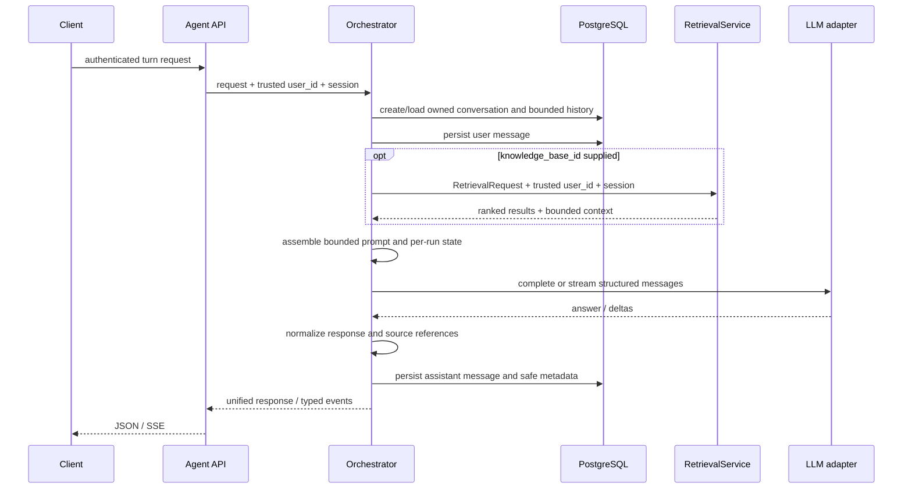

# Agent orchestration architecture

Status: final architecture recommendation for the initial implementation. This document defines the recommended choices; implementation remains a separate task.

## Executive recommendation

Add a provider-neutral, single-agent orchestration layer in `app/agent/`. Use a regular asynchronous Python service as the first runtime: it loads conversation context, optionally calls the existing retrieval service, constructs a bounded prompt, calls an LLM port, and persists the result. Add explicit tool-call handling only when the product needs tools beyond retrieval. This keeps the first implementation testable and avoids adopting a graph runtime without a graph-shaped requirement.

Existing LangChain/LangGraph chat code and `GeminiClient` are experimental implementations, not production foundations. The new agent must have its own production request path, provider port, runtime, lifecycle, and dependency wiring. Do not inherit their prompt assembly, fallback, state, or error-handling behavior. Start with a direct async orchestration service; introduce a framework only if production requirements later demonstrate a need for graph execution or durable checkpoints.

## Repository audit

| Area | Existing shape | Consequence for agent orchestration |
|---|---|---|
| Agent package | `app/agent/` exists and is empty. | Place the domain orchestration modules here; keep HTTP wiring under `app/api/v1/` and schemas under `app/schemas/`, consistent with current layout. |
| Ingestion | `app/rag/ingestion/` normalizes, chunks, and coordinates document/version/job state; `workers/` dispatches asynchronous ingestion. | Agent calls must not load, chunk, embed, or index documents. |
| Retrieval | `RetrievalService.retrieve(RetrievalRequest, authenticated_user_id, session)` returns ranked `RetrievalResult` records and bounded `AssembledContext`. Its preparer validates scope and resolves active versions from user-owned documents. | The agent must call this service; it must not query Qdrant or reimplement authorization/retrieval. Treat its context and provenance as the source context. |
| Authentication | FastAPI uses `get_current_access_claims`; authenticated identity is the token `sub`. Existing routes derive `user_id` from claims. | Resolve a trusted principal at the route boundary and pass it as a separate, required service argument. Never put user identity in request schemas. |
| Conversation persistence | `ChatSession` has an owning `user_id`; `ChatMessage` has `chat_id`, `user_id`, role, content, and timestamp. `ChatService.get_chat` scopes by chat ID and user ID; message queries also filter on both. Support chat has parallel dedicated tables. | Prefer the existing general chat tables for initial agent conversations to avoid duplicate conversation infrastructure. Agent persistence needs a careful extension for message metadata and atomic turn handling. Do not reuse support chat tables. |
| LLM integrations | Experimental `GeminiClient`, LangChain and LangGraph chat gateways exist. The current source config has `gemini_model` defaulted to `gemini-2.5-flash`, but existing adapters have fallback/model-switching behavior and are not accepted as production quality. | Implement a dedicated production LLM adapter behind the new agent provider port. Reuse approved server configuration inputs and initial provider/model choice, not experimental adapter/runtime behavior. |
| Framework use | `langchain`, `langgraph`, `langchain-openai`, and `google-genai` are dependencies; current usage is experimental. | Dependency presence is not an architectural requirement. A small async orchestration service and dedicated provider adapter are sufficient initially; add no framework or infrastructure service without a proven need. |
| API/dependency wiring | Routers are registered in `app/routers/api.py`. FastAPI dependencies and `get_*` factories wire services; retrieval exposes `get_retrieval_service()` and tests use dependency overrides. | Add an agent dependency factory using the same pattern; inject service ports so unit tests can use fakes. |
| Configuration | Pydantic `Settings` centralizes current provider keys/models and RAG defaults. `gemini_model` has a source default of `gemini-2.5-flash`; `use_langgraph_chat` selects an experimental chat runtime. | Use server-owned configuration for the approved initial provider/model. Do not use the experimental runtime switch in the new agent. Add dedicated agent timeout/output/retry settings with the approved defaults. Never expose credentials or model selection in schemas. |
| Errors/logging | Routes translate domain errors into HTTP errors; services use module loggers and avoid leaking provider details. | Keep domain errors in `app/agent/`, map them at the API edge, and log request/conversation IDs and timings without prompts, tokens, or user content. |
| Tests | Pytest unit/API tests use fakes, dependency overrides, and async test clients; RAG has focused service tests. Integration tests are separately marked. | Cover orchestrator logic with fake retrieval/provider/store ports; API tests must verify user scoping and stream event order. No live services should be needed for ordinary tests. |

### Existing experimental implementations

- Existing LLM clients and chat gateways are experiments. They may help locate current configuration values, but the production agent must not depend on their runtime, prompt assembly, fallback behavior, or provider error handling.
- `ChatMessage` only allows `user`, `assistant`, and `system` roles and has no structured metadata field for citations or tool events. If tool calls are persisted as first-class messages, add a reviewed migration or keep them in assistant metadata; do not silently broaden the existing API contract.
- Existing `ChatService` has an experimental retrieval-context builder, vector memory behavior, provider-specific initialization, and streaming methods. The new agent must not call that service; it should consume the existing retrieval service directly and own its orchestration.
- The retrieval request carries `knowledge_base_id` and retrieval options, but no identity. Its service requires trusted `authenticated_user_id` and a database session. Preserve this exact trust split.
- Existing stream surfaces include WebSocket and support event patterns. For the new text agent, Server-Sent Events (SSE) is the recommended first transport for a normal HTTP request that streams tokens; reuse the event contract if WebSocket support is later needed.

## Recommended directory structure

```text
app/agent/
  __init__.py
  models.py             # provider-neutral request, result, state and event values
  ports.py              # LLM, retrieval, conversation store and tool protocols
  orchestrator.py       # one-turn use case and execution sequence
  runtime.py            # simple runtime policy: retrieval, prompt, model, processing
  prompts.py             # system prompt templates and version identifiers
  context.py             # history selection and prompt-budget assembly
  tools/
    __init__.py
    registry.py          # explicit allowlisted tool registration and lookup
    retrieval.py         # adapter to existing RetrievalService, if exposed as a tool
  persistence.py         # ChatSession/ChatMessage-backed conversation store
  dependencies.py        # construction/wiring of production ports and service
  errors.py              # stable domain exceptions
app/infra/llm/providers/gemini.py # dedicated production adapter for configured provider
app/api/v1/agent.py      # authenticated routes and SSE serialization
app/schemas/agent_api.py # request/response/event-facing schemas
```

The exact file split can remain smaller until it is needed. In particular, do not create a second retrieval package or a framework-specific graph package in the first iteration.

## Component responsibilities and boundaries

### Agent API

Owns transport concerns only: validate the payload, obtain the authenticated user from access claims, pass the database session and trusted user ID to the use case, map expected errors, and serialize either JSON or SSE. The route does not assemble prompts, call providers, or perform direct database scope lookups outside the conversation store.

Approved routes:

- `POST /api/v1/agent/turn` — one-shot JSON interaction.
- `POST /api/v1/agent/turn/stream` — same request body, `text/event-stream` response consumed with browser Fetch streaming. Existing bearer authentication applies to the POST request.
- `GET /api/v1/agent/conversations/{conversation_id}/messages` — optional if the existing chat messages route is not used for the agent UI.

Use a router dependency for authenticated claims and the existing `get_db`. For unknown or foreign-owned conversations, return the same not-found result, as current chat/retrieval surfaces do.

### Orchestrator

Coordinates one user turn and owns sequencing, not provider or storage details. It must require the trusted `user_id` as an argument. It loads/creates an owned conversation, loads bounded history, records the user turn, asks the runtime for a response, records the completed assistant response and metadata, then returns a provider-neutral result. Streaming yields typed events and commits the assistant result only on successful completion (or records an explicit failed/incomplete turn according to the persistence decision below).

### Runtime and state

The initial runtime is a small explicit state transition sequence, not a general-purpose autonomous loop. Streaming and non-streaming use one underlying runtime and the same request preparation, retrieval, prompt construction, citation validation, persistence, and canonical response assembly. The synchronous method collects the runtime's generation result; the streaming method emits typed progress/delta events from that same execution path and ends with the complete canonical `AgentResponse`.

1. validate runtime options and establish a request/run ID;
2. load recent conversation history;
3. retrieve context when a knowledge base was requested;
4. build bounded model messages;
5. generate or stream model output;
6. validate inline citations against the retrieved source set and process output;
7. persist and return.

Represent state as a typed per-invocation value, not a process-global mutable dictionary. Suggested fields: `run_id`, trusted `user_id`, `conversation_id`, current user message, selected retrieval scope, history, retrieved chunks/context, model messages, tool results, partial/final output, and usage/finish metadata. Do not store authoritative user ownership in a client-controlled state blob. Do not require Redis, a checkpointer, or long-lived in-memory session state for ordinary text turns.

### Production deployment and scaling

Keep the API and orchestrator stateless across requests and processes. Each run owns its state locally; PostgreSQL remains the shared source of truth for conversations and messages. This lets ordinary HTTP instances scale horizontally without sticky sessions or a new orchestration service. Do not hold a database transaction or connection open during retrieval/provider network calls; use short transactions for authorization, history snapshots, and persistence. Configure database pooling and per-process provider concurrency/timeouts so load is bounded. Propagate request cancellation and shutdown cancellation to provider streams. Do not add Redis, a task queue, or durable graph checkpoints for synchronous turns. If future workloads require resumable long-running jobs or background execution, add a durable run lifecycle deliberately as a separate evolution.

Conversation turn ordering must also be safe across multiple API instances. Do not rely on an in-process mutex. At implementation, use a database-backed optimistic version/active-turn check to reject concurrent writes to the same conversation with a stable conflict response; keep the provider call outside the database transaction. Do not introduce a distributed lock service solely for conversation ordering.

### Context management and prompts

The context manager selects a bounded recent history and composes it with the latest user message and retrieved context under a configured prompt budget. Retrieval already bounds assembled context by characters and optional tokens; the agent still needs an overall model input budget that accounts for system instructions, history, retrieved context, and output allowance. Preserve message roles as structured messages rather than flattening all history into a string, where provider adapters allow it. Prompt templates should have explicit names/versions so behavior is reproducible. Treat retrieved document text as untrusted data, not instructions.

### Retrieval integration

Define an agent-facing port that delegates to `RetrievalService.retrieve`. The adapter maps the optional knowledge-base scope and supported retrieval options into `RetrievalRequest`, passes `authenticated_user_id` from trusted orchestration context plus the request-scoped `AsyncSession`, and returns both results and `AssembledContext`. When no knowledge base is requested, skip retrieval. When the service rejects scope, preserve its authorization semantics; never fall back to global or another user's scope.

Returned `RetrievalResult` values already include document/version/chunk IDs, score, page/heading information, and source reference. Carry these into response citations. Do not reveal internal Qdrant payloads wholesale.

### LLM provider abstraction

Define a provider-neutral `LLMPort` in `app/agent/ports.py`; provider implementations remain in `app/infra/llm/`. Suggested input and output contract:

```python
class LLMPort(Protocol):
    async def complete(self, request: LLMRequest) -> LLMResult: ...
    def stream(self, request: LLMRequest) -> AsyncIterator[LLMEvent]: ...
```

`LLMRequest` contains structured messages, selected model options from server configuration (including the configured model, timeout, and maximum output tokens), and an optional allowlisted tool schema set. `LLMResult` contains text, structured tool calls (if supported), finish reason, and safe usage metadata. `LLMEvent` contains text deltas and, only if the chosen provider can support it reliably, structured tool-call deltas. Hide provider SDK response types behind adapters. Resolve the provider/model in dependency wiring or a server-side registry; an untrusted request must not name arbitrary providers or credentials. Add providers one adapter at a time without changing the orchestrator contract.

The initial production adapter is dedicated to the approved configured provider/model, currently identified by the source setting `gemini_model` (source default `gemini-2.5-flash`). Inspect the effective application configuration during implementation; do not inspect or print `.env` secrets. Implement the provider port as a production adapter with explicit timeout, output-token controls, safe error classification, cancellation, and supported streaming semantics. Do not wrap or extend the experimental `GeminiClient`, inherit its alternate-model/canned-response fallbacks, or present provider failure as a successful answer. Keep this adapter isolated from orchestration so the configured provider can later be replaced or expanded without rewriting the runtime.

Apply a 120-second generation deadline and a maximum of 2,048 output tokens by default, both configurable through dedicated agent settings/environment values. Retry only bounded transient failures before any stream event containing generated text has been emitted. Once output begins, never restart generation or transparently retry; terminate the run with a safe error event. Non-streaming generation may retry transient errors within the same configured bound. Do not retry validation, authorization, or other permanent errors.

### Tool registry

Start with an explicit registry of named tool specifications: name, description, validated input schema, handler, and execution policy (timeout, idempotency/read-only classification, and whether approval is required). Each handler receives a typed execution context containing trusted user ID, conversation ID, DB session if needed, and cancellation/deadline. The model proposes calls; the runtime validates names and arguments against registered schemas before execution. Never expose arbitrary Python functions, shell execution, or unrestricted service access to the model. Retrieval can first remain a deterministic runtime step; register it as a model-selectable tool only if the product requires the model to choose when to search.

The first release can have an empty or small allowlist. Tool cycles, limits, and duplicate-call behavior must be bounded before enabling model-driven calls.

### Response processing and inline citations

Assign stable, per-answer numeric citation IDs (`[1]`, `[2]`, ...) to the retrieved chunks supplied to generation. The prompt must instruct the model to cite only these IDs and to make no citation when no retrieved source supports a claim. Validate every generated marker against the IDs in the current run; remove or normalize unknown markers before they are sent as text and before persistence. The stream validator must buffer a partial marker across provider chunks so it cannot leak an invalid half-marker. Do not invent replacement citations. No retrieval means no inline markers and an empty sources array.

The canonical `AgentResponse` includes the final assistant text and a structured `citations` array. Each entry retains citation number, document ID, document-version ID, chunk ID, source reference, page numbers, and section/heading path from `RetrievalResult`. Return only safe provenance fields, never raw Qdrant metadata. Emit the `sources` event before answer deltas so clients can render references while reading. The terminal `run.completed` event carries the complete canonical response, matching the non-streaming JSON response. The model may choose not to cite a provided source; the server must not append citations on its behalf.

## Request and response contracts

The following are design shapes, not committed Pydantic schemas. Extra fields should be rejected, and all limits should be explicit.

### Request

```json
{
  "conversation_id": "optional-existing-id",
  "message": "What does the policy say about retention?",
  "knowledge_base_id": "optional-owned-kb-id",
  "retrieval": {
    "document_ids": [],
    "top_k": 5,
    "strategy": "hybrid",
    "score_threshold": null
  }
}
```

`conversation_id` omitted means create a new conversation. `message` is required, trimmed, and bounded. `knowledge_base_id` omitted means no document retrieval for this turn. Retrieval options should mirror only supported fields of `RetrievalRequest`; set safe defaults server-side. `user_id`, provider credentials, provider/model names, system prompts, arbitrary tools, and prior conversation history are never request inputs. The V1 adapter resolves provider/model only from server configuration.

### Synchronous JSON response

```json
{
  "conversation_id": "...",
  "run_id": "...",
  "user_message": {"id": "...", "role": "user", "content": "...", "created_at": "..."},
  "assistant_message": {"id": "...", "role": "assistant", "content": "...", "created_at": "..."},
  "citations": [
    {"citation_number": 1, "document_id": "...", "document_version_id": "...", "chunk_id": "...", "source_ref": "...", "page_numbers": [2], "heading_path": ["Retention"]}
  ],
  "finish_reason": "stop"
}
```

Do not return internal prompts, raw provider payloads, secret configuration, or unrestricted retrieval payload metadata. Usage counters may be returned if desired, subject to provider-independent normalization.

### Streaming response

Use SSE frames with JSON data and a stable envelope. Suggested event sequence:

```text
event: run.started
data: {"run_id":"...","conversation_id":"..."}

event: message.started
data: {"message_id":"...","role":"assistant"}

event: sources
data: {"items":[{"citation_number":1,"document_id":"...","document_version_id":"...","chunk_id":"...","page_numbers":[2],"heading_path":["Retention"]}]}

event: message.delta
data: {"text":"The retention period is [1]..."}

event: run.completed
data: {"response":{"conversation_id":"...","run_id":"...","user_message":{"id":"...","role":"user","content":"...","created_at":"..."},"assistant_message":{"id":"...","role":"assistant","content":"...","created_at":"..."},"citations":[{"citation_number":1,"document_id":"...","document_version_id":"...","chunk_id":"...","page_numbers":[2],"heading_path":["Retention"]}],"finish_reason":"stop"}}
```

Failure after headers should emit `run.error` with a stable safe error code and then close; do not include exception strings, provider response bodies, or credentials. Clients should treat only `run.completed` as a successfully persisted final answer. Observe request disconnection/cancellation and cancel the provider stream, stop orchestration, and avoid persisting incomplete assistant content. The same underlying request and response value objects serve both streaming and non-streaming calls; SSE framing is transport-specific.

## Agent service interface

Suggested service-level contracts:

```python
class AgentOrchestratorPort(Protocol):
    async def run(
        self, request: AgentTurnRequest, *, authenticated_user_id: str,
        session: AsyncSession,
    ) -> AgentResponse: ...

    async def stream(
        self, request: AgentTurnRequest, *, authenticated_user_id: str,
        session: AsyncSession,
    ) -> AsyncIterator[AgentEvent]: ...
```

Keep domain types separate from FastAPI `Request`, `StreamingResponse`, and provider SDK types. The final event must carry the complete canonical `AgentResponse`, not just a message ID or finish reason. Ensure the response persistence transaction is explicit: the provider call is outside the DB transaction; use short transactions to create/load the conversation and persist turn records.

Supporting ports:

- `ConversationStore`: create/get/list history/append message; every operation that accepts a conversation ID also requires trusted user ID.
- `RetrievalPort`: call the existing retrieval service with request scope, trusted identity, and session; return context and provenance.
- `LLMPort`: complete and stream structured messages.
- `ToolRegistryPort`: resolve only registered tools and execute validated calls under bounded policy.
- `PromptProvider`: resolve a named/versioned system prompt from application code/configuration.

## Conversation history and persistence

Use PostgreSQL as the durable conversation store. Reuse `ChatSession` and `ChatMessage` through an agent-specific store adapter. This follows the familiar account-owned conversation history pattern: a conversation can be revisited, renamed, archived, and continued; each message remains attached to the conversation and user. Keep the existing `/api/v1/chats` behavior and response schemas stable. Add an explicit `kind` discriminator to `ChatSession` (defaulting existing rows to their current general-chat behavior) so agent routes can list only agent conversations without exposing agent-specific records through unrelated chat flows. This requires a small migration and model/API compatibility review during implementation.

Recommended persistence approach:

1. Add an Alembic migration for a conversation `kind` discriminator and nullable message metadata JSON. Store citation references, run ID, finish status, and concise tool-call summaries there. Keep canonical user/assistant text in `content`; never store hidden reasoning, full rendered prompts, credentials, or raw provider payloads.
2. Persist the user message before provider execution. Persist an assistant message only after the provider completes successfully. On provider error or client disconnect, emit a safe terminal error, leave the user message in history, and do not store truncated output as a normal assistant answer. A retry is a new turn. This is simple and makes history unambiguous; resumable runs are out of scope.
3. Load a bounded recent window from the current conversation for every turn. Do not search other conversations or infer cross-chat memories in the first release. If cross-conversation memory is added later, make it separately configurable, user-visible, source-attributed, and deletable without deleting the source chat.
4. Archive conversations with existing soft-archive behavior; scope list/get/message operations to both conversation ID and authenticated user ID. Do not add hard deletion or automatic retention purging in V1. Document future retention requirements separately if they arise.
5. Keep conversation history in PostgreSQL and derive the prompt window from stored messages. Do not add Redis or LangGraph checkpoint storage for ordinary request/response state.

Dedicated agent conversation tables are not recommended for the initial release. Revisit only if agent conversations require a separate retention lifecycle or message structure that cannot be represented without destabilizing the existing chat tables.

## Execution flow



## Testing strategy

- Unit-test context budgeting, prompt rendering, event ordering, source mapping, finish/error states, tool argument validation, and history limits without provider SDKs.
- Test the orchestrator with fake conversation store, retrieval port, and LLM port. Assert retrieval is skipped without a KB and receives the trusted user ID when enabled.
- API-test authenticated identity derivation: client-supplied `user_id` is rejected, foreign conversation IDs return not found, and a foreign KB never reaches generation.
- Test sync and streaming contracts, including provider failure before first token, failure after partial output, client disconnect cancellation, and exactly one terminal event.
- Persistence-test user-scoped conversation reads/writes and the migration/model contract. Test that only completed responses produce a normal successful assistant record.
- Keep live provider, PostgreSQL, and vector-store tests separately marked integration; ordinary tests use fakes, consistent with current repository convention.

## Approved V1 decisions

These decisions are approved inputs to implementation. They refine runtime/API details without changing the modular, provider-neutral architecture above.

| Area | Approved V1 decision |
|---|---|
| Streaming protocol | SSE-style typed events over HTTP POST, consumed with browser Fetch streaming. Use existing bearer authentication. Observe disconnect/cancellation and cancel the provider/runtime. Do not add WebSockets unless frontend inspection proves they are required. |
| Unified runtime | Streaming and non-streaming share the same orchestration execution path and canonical request/response types. The completed stream event carries the full canonical `AgentResponse`. |
| Initial provider/model | Use the approved existing configured provider/model choice; current source configuration is Gemini with `Settings.gemini_model` defaulting to `gemini-2.5-flash`. Build a dedicated production adapter rather than reuse the experimental Gemini integration. Verify the effective deployment setting during implementation without reading or exposing `.env` secrets. |
| Generation limits | Default generation deadline is 120 seconds; default maximum output is 2,048 tokens. Both are configurable through application settings/environment. |
| Retries | Default to at most 2 retries for transient failures, configurable through application settings. Never retry a stream after generated text has been emitted. Do not retry authorization, validation, or permanent provider errors. |
| Citations | Generate inline numbered markers such as `[1]` and return a structured `citations` array. Preserve document, version, chunk, page, and section/heading references. Markers must map to retrieved sources; validate before emitting/persisting and never fabricate them. Without retrieval, emit no citation markers and return an empty array. |
| Retention | Keep existing archive semantics. No hard-delete endpoint, irreversible deletion, or automatic retention purge in V1. Record future retention policy as a separate product requirement. |
| Model choice | No user model selection or model-selection UI in V1. Provider/model remain server-configured; API clients cannot supply model names or credentials. Preserve the provider abstraction for a future allowlisted selection feature. |
| Conversation context | Persist turns in PostgreSQL and use bounded history from the current conversation only. No cross-chat memory in V1. |
| Tools/framework | Retrieval remains deterministic. No multi-agent system or model-driven tool cycle until a concrete tool requirement exists. |

### Implementation risks and controls

- **Experimental provider behavior:** current LLM clients can use canned fallback responses, alternate models, and short timeouts. The dedicated production adapter must implement strict configured-model behavior, typed errors, timeout/cancellation, and output limits independently; it must never present a fallback as a grounded answer.
- **Citation leakage during streaming:** model output can split a citation marker across chunks or invent a number. Validate citation tokens against the run's retrieved source IDs before emitting them; buffer partial markers. The final canonical response and persisted content must exactly reflect the validated text.
- **Retry duplication:** retry only before generated output reaches the client. After first delta, emit a safe terminal error on failure and leave the incomplete assistant answer unpersisted.
- **Disconnect cleanup:** cancellation must propagate through the runtime to close the provider stream and avoid persisting a partial answer. The user message remains a valid history item.
- **Cross-user disclosure:** ownership is enforced by the conversation store and `RetrievalService`; request data cannot supply trusted identity.
- **Stale KB authorization:** reauthorize every retrieval turn against the authenticated user and currently active versions.
- **Context overflow and prompt injection:** bound history and retrieved context within a total model budget; treat document text as untrusted data.
- **Persistence compatibility:** distinguish agent conversations while preserving existing chat API contracts; archive rather than hard-delete.
- **Horizontal scaling:** keep run state out of process globals, use PostgreSQL for shared conversation state, and enforce turn-order conflicts in the database rather than a local lock.

No product decision remains open for the V1 behavior listed above. At implementation time, confirm the frontend's Fetch streaming support and inspect effective server provider/model configuration as required by the approved decisions. Neither confirmation changes the architecture; if Fetch streaming is unsupported, pause before choosing a different transport.

## Audit completion

This document is the final architecture recommendation with approved V1 decisions recorded. It does not implement the orchestration, API, schema, migration, dependency wiring, or tests; those changes belong to their relevant development steps. The audit inspected source configuration and code without reading `.env` secrets. No test suite was run because implementation was not requested in this step.
