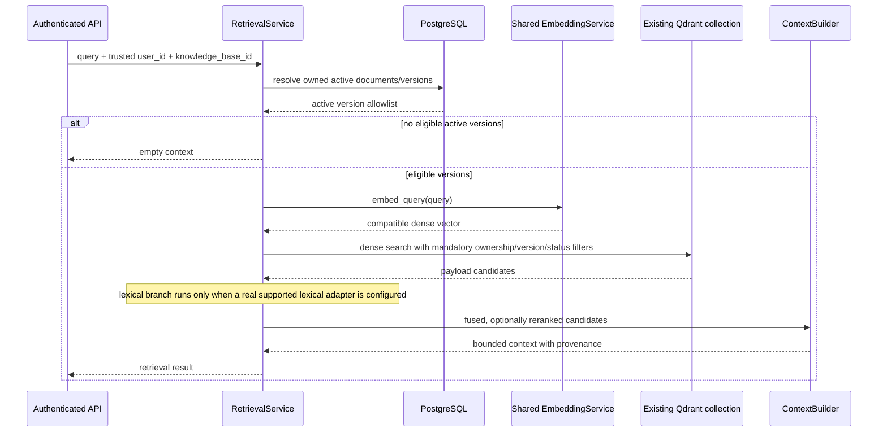

# Phase 3: Retrieval pipeline architecture

**Status:** query validation, authorization, and dense vector retrieval implemented; lexical, hybrid, reranking, context assembly, and end-to-end orchestration remain unimplemented.
**Boundary:** the new pipeline under `app/rag/`; the experimental chat/document search remains untouched.

## 1. Existing component audit

### Ingestion output and chunk contract

`StructuralChunker` emits immutable `DocumentChunk` values (`app/rag/models/chunk.py`) containing `id`, `content`, token count, ordinal, document and user IDs, optional knowledge-base ID, heading path, page numbers, and JSON-like metadata. Chunk text includes active headings, and structural provenance is retained. Document version is supplied separately in `DocumentIndexScope`, not on each chunk.

The worker path is `RagIngestionWorkflow` (`app/rag/ingestion/workflow.py`). It embeds chunks with `EmbeddingService`, upserts deterministic point IDs, marks Qdrant points active, then changes PostgreSQL's `RagDocument.active_version_id`. The order matters: PostgreSQL is the authoritative active-version pointer. A failed or cancelled replacement must not become visible merely because some Qdrant points exist.

### Qdrant collection and dense vectors

The new ingestion worker passes `Settings.qdrant_collection_name` to `DenseDocumentIndexer`; the setting defaults to `rag_chunks_v1`. `Settings.qdrant_vector_size` defaults to 1536. Provider defaults in `app/rag/dependencies.py` include OpenAI `text-embedding-3-small` at 1536, Google at 768, and Hugging Face MiniLM at 384. The builder rejects a configured embedding dimension that differs from the configured Qdrant dimension. At runtime, `DenseDocumentIndexer.validate_collection` additionally requires an already-existing collection with one unnamed dense vector and checks its actual dimension. It never creates a collection.

The repository also has a separate legacy `UserVectorStore` path (`app/services/user_vector_store.py`): it defaults to `user_documents_v1` and 256 dimensions and creates collections itself. Its vectors come from deterministic `embed_user_memory_text`, not the new provider service. `app/infra/vector_stores/qdrant.py` is another general adapter with create/ensure behavior and filters for legacy `collection_id`; it is not yet sufficient as-is for new retrieval filters. These paths must not be conflated. Repository defaults are not evidence of the live Qdrant collection names, dimensions, distance metric, or payload indexes.

### Dense and lexical indexing

The production new ingestion path uses `EmbeddingService` for document vectors and `DenseDocumentIndexer` for Qdrant writes. `app/rag/indexing/service.py` is a separate indexing service that calls the legacy deterministic hash embedding helper; it is not the worker's new ingestion path and should not be used to embed retrieval queries for provider-indexed points.

Despite its filename, `app/rag/indexing/sparse_indexer.py` contains only a compatibility note. It says the intended existing collection is unnamed dense-only and that searchable text and metadata are stored in payloads. There is no sparse-vector creation, token index, BM25 implementation, lexical query code, or lexical test. Therefore lexical retrieval currently has no implementation or established scoring semantics. Do not label the current system BM25 or claim sparse indexing exists.

### Embedding compatibility

`EmbeddingProvider` defines both `embed_query` and `embed_documents`; `EmbeddingService` validates dimensions, retries transient errors, validates numeric finite vectors, and exposes both operations. `build_embedding_service` selects one provider instance/configuration for both indexing and query-time use. New retrieval must inject this existing service and call `embed_query`; it must not add another embedding provider or call `embed_user_memory_text`.

### Qdrant payload and scope

The new worker payload has top-level `record_type=rag_chunk`, `content`, `user_id`, `knowledge_base_id`, `document_id`, `document_version_id`, `chunk_id`, `chunk_index`, `token_count`, `heading_path`, `page_numbers`, `source`, `metadata`, and `index_status`. Metadata includes parser/chunk provenance and embedding provider/model/dimensions. Indexing first writes `staging`, then updates the new version points to `active`; superseded and failed point cleanup is coordinated with PostgreSQL.

`RagDocument` is keyed with `user_id`, `knowledge_base_id`, `active_version_id`, and lifecycle status. `RagDocumentVersion` stores the user, document, version status and metadata. The knowledge-base ID is currently a string, not a foreign key to a knowledge-base ownership model. Retrieval scope must therefore be derived from trusted authenticated `user_id` and validated against PostgreSQL document rows. Do not accept user identity from a query body. Resolve eligible document/version IDs where document ownership and knowledge-base match, document status is active, `active_version_id` is set, and that version is indexed. Apply those version IDs together with `user_id`, `knowledge_base_id`, and `index_status=active` in Qdrant. Empty eligible-version scope must return no hits without issuing an unscoped Qdrant query.

The new indexing adapter does not create payload indexes. The existing general Qdrant adapter does not filter `knowledge_base_id` or `index_status` and uses the legacy `collection_id` concept. A retrieval-capable Qdrant query operation needs explicit support for the new payload fields and a check of payload-index/performance requirements for the deployed collection.

### Existing retrieval, API, and application wiring

The query foundation is implemented in `app/rag/retrieval/query_processor.py` and `app/rag/models/retrieval.py`. It validates query/filter inputs, binds trusted user identity, resolves the user's knowledge-base and active document-version scope from PostgreSQL, and provides mandatory Qdrant filter construction. Dense retrieval is implemented in `app/rag/retrieval/semantic.py`; lexical, hybrid, fusion, reranking, context assembly, and end-to-end strategy orchestration remain unimplemented. `app/rag/ports/reranker.py` still defines no protocol.

The older experimental retrieval path is in `app/services/user_vector_store.py` and `DocumentService` / `ChatService`. It queries vector similarity using the deterministic hash embedding, supports user and chat/global visibility filters, and has an API route at `GET /api/v1/chats/{chat_id}/documents/search`. The chat service also inserts this old retrieval context into model requests. It does not resolve new PostgreSQL active versions or knowledge-base scope and has a different payload/identity contract. Do not alter it in Phase 3 design implementation.

The API uses FastAPI routers, `Depends` for database/auth context, `claims["sub"]` as the authenticated user, and service getters such as `get_chat_service`. The new ingestion worker uses an explicit factory in `workers/tasks/ingestion.py`, `lru_cache` for the synchronous session factory, and constructor injection for services and adapters. Retrieval should follow the same provider-neutral port / infrastructure adapter separation and use async database sessions (`app/db/session.py`) at the API boundary. No new public API or chat integration is defined by this audit.

Tests are pytest-based, with async tests marked by `pytest.mark.asyncio`, fakes for Qdrant/providers, and infrastructure-backed tests marked `integration`. Existing RAG tests are organized under `tests/rag/`.

## 2. Proposed architecture

Keep orchestration and provider-neutral models in `app/rag/retrieval/`; keep Qdrant-specific calls in `app/infra/vector_stores/`; reuse `EmbeddingService`; use PostgreSQL only to resolve trusted active document scope. The first deliverable should support dense retrieval end to end. Keep lexical retrieval behind an optional interface, but leave it unavailable until an existing lexical implementation and its scoring/index behavior are confirmed. Hybrid fusion can be composed when two real result sets exist; it must not fabricate a lexical result source.

### Proposed modules

```text
app/rag/
  models/retrieval.py              # Request, authorized query context, candidate types
  ports/
    embedding_provider.py          # Existing shared provider contract
    vector_store.py                # Extend with scoped dense query contract
    lexical_store.py               # Future optional lexical-search contract
    reranker.py                    # Optional candidate reranking contract
  retrieval/
    query_processor.py             # Input validation, normalization, ownership and active versions
    semantic.py                    # Dense query embedding and scoped Qdrant retrieval
    dependencies.py                # FastAPI auth/database and dense strategy wiring
    scope_resolver.py              # Future extraction point if scope resolution grows
    semantic.py                    # Embed query and invoke dense search port
    lexical.py                     # Optional adapter orchestration; disabled by default
    fusion.py                      # Rank/score combination over actual candidates
    hybrid.py                      # Coordinate enabled retrievers and fusion
    reranking.py                   # Optional reranker orchestration
    context_builder.py             # Deduplicate, order, and budget chunks
    service.py                     # End-to-end retrieval use case
  dependencies.py                 # Extend construction with retrieval dependencies
app/infra/vector_stores/qdrant.py  # Qdrant scoped dense-search implementation
tests/rag/test_retrieval_*.py      # Unit contract and orchestration tests
```

`lexical_store.py` is a proposed port location, not a claim that such a store exists. `QdrantVectorStore.build_retrieval_filter` now constructs mandatory ownership/version/status filters; it does not execute a search. Keep lexical retrieval disabled until a concrete implementation can use the existing approved infrastructure and tests establish its behavior. Do not add a search engine, sparse vectors, or a new collection as part of this design.

## 3. Responsibilities and interface definitions

The implemented request and query context types live in `app/rag/models/retrieval.py`. Strategy signatures below remain design contracts, not search implementations.

The implemented `RetrievalRequest` requires `query` and `knowledge_base_id`; it accepts optional `document_ids`, `metadata_filters`, `top_k`, `score_threshold`, and `strategy`. It forbids extra fields, including `user_id`. `RetrievalQueryContext` adds the server-derived `user_id` and the PostgreSQL-resolved `active_version_ids` for downstream strategies. `RetrievalCandidate` is the provider-neutral future result type.

| Interface | Responsibility | Proposed contract |
|---|---|---|
| Query processing | Reject blank/oversized input, normalize outer whitespace only, validate limits, preserve original text semantics. No implicit query expansion. | `RetrievalQueryProcessor.process(request, *, authenticated_user_id) -> ProcessedRetrievalRequest` |
| Ownership and active scope | Require a known user-owned knowledge base, deny requested document IDs outside it, and resolve only active/indexed document versions. | `RetrievalRequestPreparer.prepare(request, *, authenticated_user_id, session) -> RetrievalQueryContext` |
| Query embedding | Reuse the one shared service/provider and the indexing configuration. | `EmbeddingService.embed_query(text: str) -> list[float]` (already implemented) |
| Dense retrieval | Embed through shared `EmbeddingService`, validate the existing unnamed dense vector dimension, apply mandatory user/knowledge-base/version/status and caller filters, threshold scores, and map payload provenance to results. | `DenseRetriever.retrieve(context: RetrievalQueryContext) -> Sequence[RetrievalResult]` |
| Lexical retrieval | Optional port for a verified lexical index implementation. A caller cannot activate it based only on payload text. | `LexicalRetriever.search(query: RetrievalQueryContext) -> Sequence[RetrievalCandidate]`; no concrete implementation exists today. |
| Hybrid fusion | Combine candidate sets from retrievers that actually ran; deduplicate by point ID. Keep fusion algorithm injectable/configurable until lexical scoring is chosen. Rank-based fusion is preferable if score scales differ, but requires product/quality evaluation. | `FusionStrategy.fuse(candidate_lists: Sequence[Sequence[RetrievalCandidate]], *, limit: int) -> Sequence[RetrievalCandidate]` |
| Optional reranking | Rerank a bounded fused candidate list using query and candidate content; absent means preserve fused order. Provider stays behind a port. | `Reranker.rerank(query: str, candidates: Sequence[RetrievalCandidate], *, limit: int) -> Sequence[RetrievalCandidate]` |
| Context assembly | Deduplicate, bound total content/token budget, retain source, document/version/chunk IDs and provenance for citations, produce ordered context. | `ContextBuilder.build(query: RetrievalQueryContext, candidates: Sequence[RetrievalCandidate], *, max_tokens: int) -> RetrievedContext` |
| Orchestration | Resolve scope first, embed once, run dense plus only enabled retrievers, fuse, optionally rerank, assemble. Empty scope returns empty context. | `RetrievalService.retrieve(text: str, *, user_id: str, knowledge_base_id: str, document_ids: Sequence[str] = ()) -> RetrievedContext` |
| Scope resolver | Query PostgreSQL under authenticated user and requested knowledge base; return only current active version IDs. Validate optional document IDs belong to same scope. | `RetrievalScopeResolver.authorize(request, *, session) -> RetrievalQueryContext` |

The `EmbeddingService` must be injected once into retrieval and built by `build_embedding_service`; no second query embedder or provider selection logic should be created. A retrieval-specific Qdrant query method may be added to the infrastructure adapter, but it must not call `ensure_collection` or create/alter a collection as a side effect.

## 4. Data flow



The scope allowlist is resolved before Qdrant so an old version cannot leak during the cross-store interval between PostgreSQL activation and Qdrant cleanup. `DenseRetriever` uses `QdrantVectorStore.build_retrieval_filter`, which rejects an empty allowlist and adds user, knowledge-base, version, active-status, document, and metadata conditions. It also checks returned payload identity and version fields before producing results. The Qdrant `index_status=active` filter is defense in depth; it is not a replacement for the allowlist.

## 5. Configuration requirements

The query foundation adds `rag_retrieval_default_top_k` (5), `rag_retrieval_max_top_k` (50), `rag_retrieval_default_score_threshold` (unset), and `rag_retrieval_default_strategy` (`dense`). It reuses `qdrant_collection_name`, `qdrant_vector_size`, embedding provider/model/dimensions, and Qdrant timeout/batch settings once retrieval is implemented. Verify the deployed collection is the same collection used by new ingestion, has an unnamed dense vector of matching dimensions, and has suitable keyword payload indexes for `user_id`, `knowledge_base_id`, `document_id`, `document_version_id`, and `index_status`. Do not assume source defaults match deployment.

Add retrieval-specific settings only when implementation needs them: candidate limit, maximum context tokens, optional reranker selection/limit, and a feature switch for an available lexical path. Defaults should keep lexical and reranking disabled until configured. Avoid new credentials/configuration for providers not selected. A collection migration or vector-schema change is outside this phase's design.

## 6. Testing strategy for implementation phase

- Unit-test query validation, scope resolution, and empty-scope behavior with fake async sessions.
- Verify Qdrant requests always include user, knowledge base, active version allowlist, and active status; verify missing filters cannot fall back to unscoped search.
- Test payload-to-candidate mapping, malformed/missing content behavior, duplicate IDs, and stable provenance.
- Test query embedding goes through the same injected `EmbeddingService` contract and rejects dimension mismatches before search.
- Test fusion with overlapping and disjoint candidate sets, tied ranks, missing retriever results, and different score scales. Do not assert BM25 semantics without an implementation.
- Test reranker disabled/enabled, candidate bounds, context token limits, source attribution, and no-result response.
- Add a marked `integration` test against a disposable/pre-provisioned Qdrant collection only after the collection schema and supported Qdrant version are agreed. Ordinary tests use fakes and do not require external services.
- Add API tests only when an endpoint or chat integration is explicitly implemented; preserve authenticated ownership and existing API contracts.

## 7. Risks and open facts

1. **Collection ambiguity:** new ingestion defaults point to `rag_chunks_v1` / 1536 dimensions, while legacy memory defaults to `user_documents_v1` / 256 dimensions. Actual deployed settings and collection schema have not been queried in this code audit. A mismatch means ingestion or query initialization should fail closed.
2. **Embedding path mismatch:** `app/rag/indexing/service.py` still uses deterministic 256-dimensional hash embeddings, unlike production worker ingestion. Retrieval must use the worker's provider path; mixing vectors makes similarity meaningless even when the dimensions happen to match.
3. **No lexical search:** the sparse indexer is documentation only. A lexical adapter, scoring semantics, index, or Qdrant full-text payload configuration remains an explicit future decision. Hybrid mode is not available until then.
4. **Active-version filtering:** stale, staging, or partially activated Qdrant points can exist around failures and cleanup. The PostgreSQL active-version allowlist and mandatory payload filters are security/correctness requirements.
5. **Payload index/performance:** the new indexer validates dense vector shape but does not provision payload indexes. Filter correctness may work without them while scaling poorly; deployed Qdrant configuration needs review.
6. **Knowledge-base authorization model:** `knowledge_base_id` has no FK/ownership table in the inspected schema. The implemented resolver infers access from `rag_documents` rows matching the authenticated user and requested KB; a KB with no document rows is inaccessible. A future KB model/API must define explicit membership/authorization rules if empty KBs or sharing are needed.
7. **API integration scope:** the existing chat route and service consume the experimental user-memory path. Replacing that behavior is a separate contract and migration decision; this design does not do so.
8. **Existing design note drift:** earlier architecture notes described the collection as 256-dimensional. That matches the legacy user-memory path but conflicts with current new-ingestion settings/provider defaults; deployment inspection is required to resolve it.
